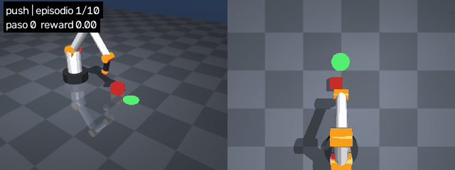

# vision-arm-rl

A 4-joint robotic arm in **MuJoCo** that learns to **reach** and **push** a cube to a target
using reinforcement learning (**PPO**, Stable-Baselines3). A vision module that finds the cube
from the overhead camera is coming next.

> 🚧 Work in progress. Right now the policies are trained on the true (simulated) cube position.



## What's done

- **Scene (`assets/arm.xml`)**: a custom 4-DoF arm (yaw, shoulder, elbow, wrist) with no gripper,
  position actuators, a red cube, a green goal zone, and three cameras (`showcase`, `front`, `overhead`).
- **Gymnasium environment (`env.py`)**: `ArmEnv` with two tasks:
  - `reach`: move the arm tip to the cube.
  - `push`: push the cube to within 3 cm of the goal. The reward guides the tip to a
    "push point" behind the cube, opposite the goal.
  - 25 Hz control, 6 s episodes, incremental joint-target actions, random cube/goal on each reset.
- **Training (`scripts/train.py`)**: PPO with 8 parallel envs, `VecNormalize`, TensorBoard logs,
  and checkpoints every 100k steps.
- **Evaluation (`scripts/evaluate.py`)**: success rate, mean reward/length, and a GIF of the
  first episodes.

## Setup

```bash
python -m venv .venv
.venv\Scripts\activate          # Windows (Linux/macOS: source .venv/bin/activate)
pip install torch --index-url https://download.pytorch.org/whl/cpu
pip install -r requirements.txt
```

Everything runs on CPU.

## Usage

```bash
# Look at the scene and move the joints with sliders
python -m mujoco.viewer --mjcf assets/arm.xml

# Check that the environment follows the Gymnasium API
python -c "from gymnasium.utils.env_checker import check_env; from env import ArmEnv; check_env(ArmEnv()); print('OK')"

# GIF of random episodes (baseline)
python scripts/record_random.py --camera both

# Train
python scripts/train.py --task reach --steps 300000
python scripts/train.py --task push  --steps 3000000

# Evaluate and record a GIF in media/
python scripts/evaluate.py --task push --episodes 100 --camera both

# Learning curves
tensorboard --logdir runs
```

Trained models (`models/`), logs (`runs/`), checkpoints and the other GIFs are not in the repo.

## Next steps

1. **Vision**: detect the cube and goal in the overhead camera image with YOLO, and convert
   pixels to table coordinates (x, y) in metres.
2. **Policy + vision**: run the policy on positions from the camera instead of the true
   state, and measure how much the success rate drops (and whether training with observation
   noise helps).
3. **Demo**: a side-by-side GIF (3D view + camera view with detections) and the results table.

## Stack

MuJoCo · Gymnasium · Stable-Baselines3 (PPO) · PyTorch · OpenCV · NumPy

## Author

All the code in this repository was written entirely by me, Álvaro Vega González, as a
learning project.
